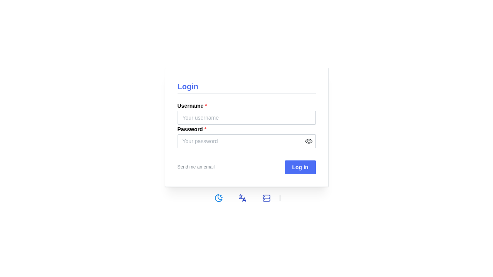

# Submission details

Student — Eman Hassan  
Roll number — **TO_BE_FILLED**  
Section — **TO_BE_FILLED**

# Executive summary

This QA continuation evaluated InvenTree's existing receive and dispatch workflows at project revision `4e72745` against eight functional requirements and four business rules. The local unit, authenticated browser, latency and restart checks passed. The accessibility audit confirmed defects on the login screen. The limited passive ZAP review reported development response findings. Three confirmed findings were filed in the SQE repository.

# Scope and design

The baseline vendors InvenTree revision `4f5fbc091b8066d29445495d3e177078df7abfcd`. The test scope covers quantity adjustment, validation, serialization, accounting, audit history, depletion and roles. Equivalence classes and boundary cases come from the existing tests and OpenAPI extract. The RTM maps FR-1 through FR-8 and BR-1 through BR-4 to actual checks. The test plan and risk register identify remaining gaps for audit history at the API layer and production database locking. SQLite is the disposable local store.

# Verified results

| Area | Observation | Evidence |
|---|---|---|
| Build | Vite production build and TypeScript check passed. Django system check identified zero issues. | Build, TypeScript and Django logs |
| CI | Baseline test and mutation jobs succeeded. SonarCloud was skipped. The intentionally failing regression PR #2 remains open. | GitHub Actions run 45547599494 and CI metadata |
| Unit | 26 original cases passed with coverage. The combined current suite passed all 30 cases in a separate run. | pytest unit logs and coverage JSON |
| Mutation | Rerun killed 13 of 15 mutants (86.7%). M02 and M13 survived. | Mutation harness output |
| White-box | Receive covered 20/20 statements and 6/6 branch arcs. Dispatch covered 27/27 and 10/10. Radon complexity was 5 and 7. | coverage JSON and Radon output |
| SonarQube | Community Build 10.6 analyzed the Stock models file. Coverage was 31.4%, with 12 code smells. The first-analysis quality gate was OK with zero returned conditions. | Scanner, measures and quality gate JSON |
| MC/DC | Reviewed outcomes for the selected methods' single-condition guards. Four cases passed for the downstream three-condition depletion rule. | Decision coverage and pytest MC/DC log |
| Browser | Receive changed 10 to 15. Dispatch changed 10 to 7. Both persisted after reload. The view-only role could inspect stock and had no enabled adjustments. | Playwright log and stock screenshots |
| Accessibility | Lighthouse login accessibility scored 85/100. Axe reported 6 login and 7 stock detail rules. Login fields and submit were keyboard reachable, with an extra unnamed focus stop. | Lighthouse and axe JSON, keyboard trace |
| Passive security | Three local responses processed. Two medium alert types concerned framing and CSP on the development UI. Low alerts concerned content-type headers and server headers. | ZAP requests, JSON and HTML |
| Dependency check | Backend audit returned zero known vulnerabilities across 165 dependencies. The npm advisory endpoint returned five direct advisory records for the installed frontend tree. | pip-audit JSON |
| Performance | 40 requests, 0 failures, 20 paired iterations, one VU. Receive p95 68.48 ms and dispatch p95 103.94 ms, each under the test's 500 ms threshold. | k6 output and balance JSON |
| Recovery | Service was unreachable after intentional stop. Balance was 10 after restart and after a successful receive/dispatch pair. | Restart log |

The CI coverage step currently accepts an XML artifact without evaluating measured thresholds. The fresh method coverage result above comes from independent local measurement.

# Product defect analysis

The login submit label measured 4.32:1 contrast against the default blue background, below 4.5:1 for its text size and weight. Keyboard focus also reached an unnamed input between password and the alternate login action. Axe identified that input as a hidden TOTP field. Both are medium-severity findings filed as GitHub issues #5 and #7. Issue #6 records the CI coverage enforcement gap. The existing open issues concern model NaN handling (#3) and resulting-quantity overflow on SQLite readback (#4).

In the four-product-finding sample, quantity validation and persistence account for 2/4 (50%), contrast for 1/4 (25%) and keyboard focus and labeling for 1/4 (25%). The two historical issues support the first count. This small Pareto sample excludes untriaged tool alerts and the separate CI finding.

{ width=57% }

# Boundaries and remaining verification

The local ZAP scope represents three nominated development responses. It does not establish production security. The k6 baseline and restart test establish local responsiveness and persistence across a between-request outage. Production concurrency and interruption during a transaction remain unverified. The existing integration suite was reviewed through CI evidence under the instruction against running integration tests locally. The QA-only scope precludes an application fix and therefore a post-fix accessibility comparison. The historical product issues remain open. A rollback-only probe reproduced the model exceptions and SQLite readback failure.

SonarQube setup encountered Docker storage failures and blocked standalone downloads. Running the official application layer directly reached Elasticsearch, which exited because the environment does not expose `/proc/self/coredump_filter`. The compatible SonarQube 10.6 Community Build completed the local file-level analysis. SonarCloud remained skipped in GitHub Actions. The evidence index records the setup attempts, scanner run and separate Radon result.

# Report and evidence guide

- Requirements and priorities are in `06_traceability_matrix.md`, `07_risk_register.md` and `08_test_plan.md`.
- Decision witnesses are in `09_decision_coverage.md`. Reproduction steps and Pareto counts are in `10_defect_analysis.md`.
- The evidenced project week and GQM metrics are in `11_weekly_progress.md`. AI participation is disclosed in `ai_use_record.md`.
- Tool versions, scope and artifact paths are in `12_execution_evidence.md`. Raw outputs are under `docs/evidence/2026-11-25/`.
