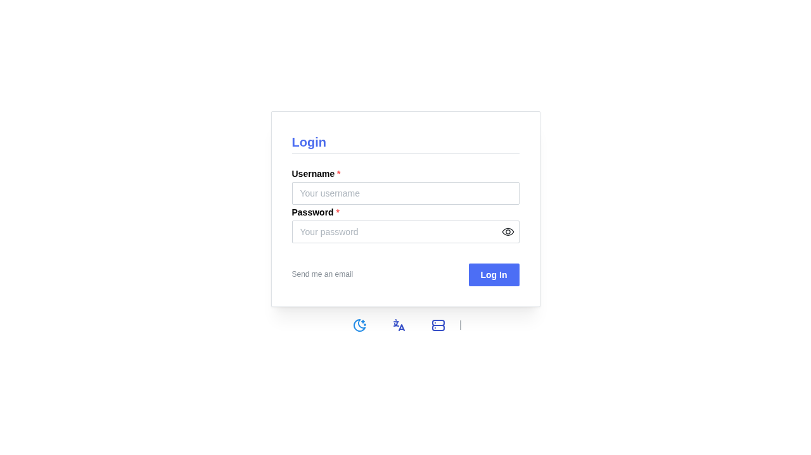
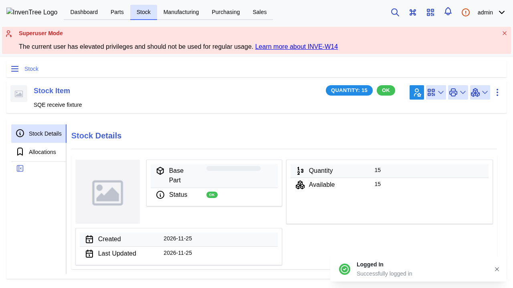
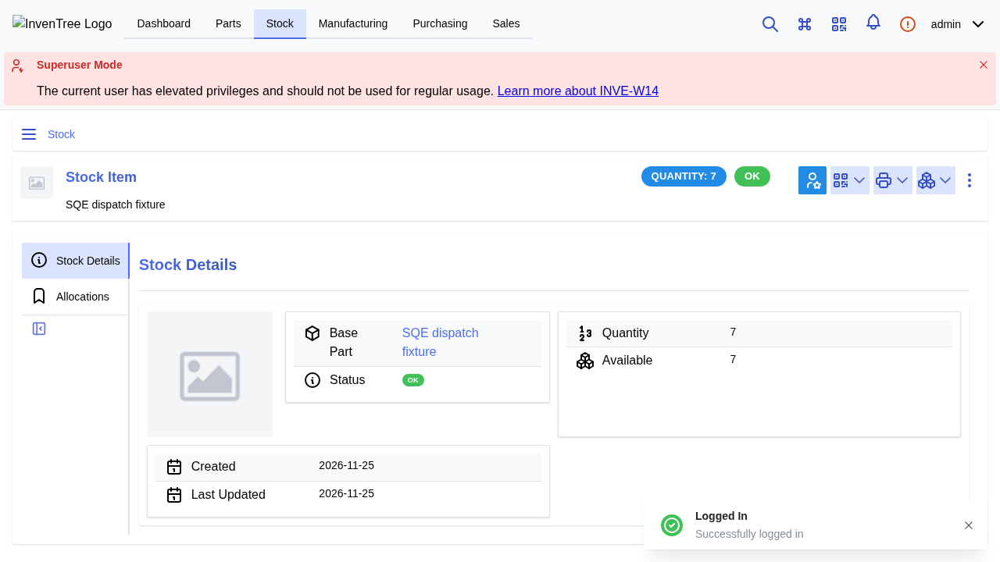

# Report basis

Section is pending confirmation. This report consolidates committed scripts, records and actual outputs. It records prior executions, rather than asserting a fresh run of every tool. Individual student ownership remains unconfirmed. Full rubric completion remains pending.

Project repository — https://github.com/syedsarimzaidi/sqe-project

Evidence checkpoint — abccfafd2303b4e73420d81098a5a73284259f94

# Result overview

Thirty combined unit cases passed. The two selected stock methods have 100% measured statement and branch coverage. SonarQube file coverage is 31.4% and reports 12 code smells. The original API suite has 18 cases and passed in recorded CI. Mutation testing killed 13 of 15 mutants. Browser receive and dispatch persisted their expected balances, and the view-only user lacked enabled adjustment actions. Login Lighthouse accessibility scored 85/100. Axe recorded six login and seven stock rule types. ZAP reviewed three nominated development responses. Backend dependency audit checked 165 packages and found zero known vulnerabilities. Frontend advisory lookup returned five direct records.

Both sustained one-user runs passed. Both five-user runs failed the reliability threshold, at 59.57% and 57.06% unexpected failures. SQLite locking appeared in server logs. The five-user measurements require clean-state repetition. Recovery evidence covers a restart between requests. Controlled interruption before a write completes remains pending.

# Environment

Python 3.12; Django 5.2.19; disposable SQLite; Node 24; Vite 7.3.7; Chromium 156; Playwright 1.65.1; axe Playwright adapter 4.14.1; Lighthouse 13.6.0; ZAP 2.17.0; k6 2.4.0; SonarQube Community Build 10.6.0.92116; SonarScanner 7.2.0.5079. The backend used loopback port 18763 and the frontend used 5173 for authenticated checks. Earlier scope examples use port 8000. Configure matching URLs for each disposable instance. Secrets are supplied via environment variables.

# Commands used and reproduction

The commands below use portable paths for reproduction. The subsequent original documentation and raw outputs supply execution context and outcomes. Run commands from the repository root unless a directory change is shown.

```bash
uv venv --python 3.12 .venv
uv pip install --python .venv/bin/python -r mis/src/backend/requirements.txt -r mis/src/backend/requirements-dev.txt pytest-cov radon
source .venv/bin/activate
python -m pytest tests/team/unit --cov=stock.models --cov-branch --cov-report=term --cov-report=json:coverage.json -q
python -m pytest tests/team/unit/test_stock_depletion_decision.py --nomigrations -q
python -m pytest tests/team/unit --nomigrations -q
radon cc mis/src/backend/InvenTree/stock/models.py -s -a
python tests/team/mutation/run_mutation.py
python tests/team/api/generate_test_data.py --spec docs/openapi_stock_workflows.json --available-quantity 10
```

The mutation rerun used a detached baseline worktree and migrated database copy because the harness writes its report. The original API tests were reviewed through CI records under the instruction against local integration runs. No fresh local API test execution is claimed.

```bash
# Original CI test command
python -m pytest tests/team/unit tests/team/api/test_stock_api.py --cov=stock.models --cov-report=term-missing --cov-report=xml:coverage.xml --cov-fail-under=0

# Frontend commands from mis/src/frontend
# Install with the committed Yarn lockfile
yarn install --frozen-lockfile
yarn compile
./node_modules/.bin/tsc --noEmit
./node_modules/.bin/vite build --outDir /path/to/disposable-build --emptyOutDir
./node_modules/.bin/vite --host 127.0.0.1

# Browser scripts copied beside disposable workspace node_modules
node stock-workflows.mjs
node login-accessibility.mjs
CHROME_PATH=/usr/bin/chromium lighthouse http://127.0.0.1:5173/web/login --only-categories=accessibility --chrome-flags='--headless --no-sandbox' --output=json --output-path=lighthouse-login.json

# Dependency audit
pip-audit --cache-dir /path/to/cache -r mis/src/backend/requirements.txt --format json

# SonarScanner with local server and token supplied separately
java -jar sonar-scanner-cli-7.2.0.5079.jar -Dsonar.host.url=http://127.0.0.1:19000 -Dsonar.scanner.skipJreProvisioning=true -Dsonar.projectKey=sqe-stock-qa -Dsonar.projectVersion=4e72745 -Dsonar.sources=mis/src/backend/InvenTree/stock/models.py -Dsonar.python.version=3.12 -Dsonar.python.coverage.reportPaths=/path/to/coverage.xml

# ZAP daemon and passive-report API
./zap.sh -daemon -dir /path/to/zap-state -host 127.0.0.1 -port 18090 -config api.disablekey=true
curl --noproxy '' -x http://127.0.0.1:18090 http://127.0.0.1:5173/web/login
curl --noproxy '' -x http://127.0.0.1:18090 http://127.0.0.1:18763/api/
curl --noproxy '' -x http://127.0.0.1:18090 http://127.0.0.1:18763/api/stock/
curl http://127.0.0.1:18090/JSON/pscan/view/recordsToScan/
curl http://127.0.0.1:18090/JSON/core/view/alerts/
curl http://127.0.0.1:18090/OTHER/core/other/htmlreport/

# Sustained workloads, after supplying disposable token and five fixture IDs
for users in 1 5; do
  for repeat in 1 2; do
    SQE_VUS="$users" SQE_DURATION=60s k6 run tests/team/performance/stock.js
  done
done
```

The retained k6 executions used the official container with host networking. Each VU used a distinct fixture. Inputs SQE_BASE_URL, SQE_TOKEN and SQE_STOCK_IDS must refer to the disposable instance. Initial fixture state was created once for the four-run sequence. Failed pairs can change later starting state. The browser scripts need SQE_CHROMIUM, SQE_EVIDENCE_DIR, SQE_ADMIN_PASSWORD, SQE_READER_PASSWORD, SQE_RECEIVE_ID and SQE_DISPATCH_ID. Use distinct stock rows starting at quantity 10. Complete setup commands and environment configuration follow in the scope section.

\newpage

# SE3002 — Section 1: Test Scope Definition

## Repository

| Field | Value |
|---|---|
| Name | InvenTree |
| Upstream URL | https://github.com/inventree/inventree/ |
| License | MIT |
| Baseline commit hash | `4f5fbc091b8066d29445495d3e177078df7abfcd` |
| Backend | Python 3.12 / Django 5.2 |
| Interface | Web UI (React/Mantine frontend) + full REST/HTTP API |
| Storage | SQLite (dev) / PostgreSQL (prod) — persistent |
| Module selected | **Stock** app (`src/backend/InvenTree/stock/`) |

Chosen because it satisfies all registration criteria: usable browser interface, HTTP API for
the selected workflows, persistent storage, testable source code, and is **not** ERPNext.

## Selected Workflows (same module: Stock)

### Workflow 1 — Receive Stock (`add_stock`)
- **Starting condition:** A `StockItem` exists with a known quantity (e.g. 0).
- **User action:** Authenticated user with stock-add permission calls `POST /api/stock/add/`
  (or UI equivalent) with a positive quantity.
- **Expected outcome:** `StockItem.quantity` increases by the supplied amount; a tracking
  history entry (`StockHistoryCode.STOCK_ADD`) is recorded.
- **Source:** `stock/models.py`, `StockItem.add_stock()`, lines 3409–3459 (commit above).

### Workflow 2 — Dispatch Stock (`take_stock`)
- **Starting condition:** A `StockItem` exists with a known non-zero quantity.
- **User action:** Authenticated user with stock-remove permission calls `POST /api/stock/remove/`
  with a quantity to remove.
- **Expected outcome:** `StockItem.quantity` decreases by the supplied amount, **clamped** to
  never go below zero (business rule — see BR-1 below); a tracking history entry
  (`StockHistoryCode.STOCK_REMOVE`) is recorded.
- **Source:** `stock/models.py`, `StockItem.take_stock()`, lines 3462–3529 (commit above).

### Shared record between workflows
`StockItem.quantity` (and its tracking history) — Workflow 1 writes to it (increases),
Workflow 2 reads it (to clamp) and writes to it (decreases). This is the shared record
required by the assignment.

## Functional Requirements (8 total, ≥3 per workflow)

**Receive stock (Workflow 1):**
1. FR-1: The system shall allow an authenticated user with add-stock permission to increase
   the quantity of an existing, non-serialized `StockItem`.
2. FR-2: The system shall reject a stock-add request with quantity ≤ 0.
3. FR-3: The system shall record a tracking/history entry for every successful stock addition.

**Dispatch stock (Workflow 2):**
4. FR-4: The system shall allow an authenticated user with remove-stock permission to decrease
   the quantity of an existing, non-serialized `StockItem`.
5. FR-5: The system shall reject a stock-remove request with quantity ≤ 0.
6. FR-6: The system shall never allow `StockItem.quantity` to fall below zero, regardless of
   the requested removal amount (see BR-1).
7. FR-7: The system shall record a tracking/history entry for every successful stock removal,
   including the case where the removed amount was clamped.

**Cross-workflow:**
8. FR-8: The system shall reflect the net effect of combined add/remove operations correctly
   in `StockItem.quantity` when operations are issued in sequence (add then remove, or
   remove then add).

## Business Rules (4 total)

- **BR-1 (boundary/limit):** Removing more stock than is currently available does not error —
  the removal is silently capped at the available quantity
  (`quantity = min(requested_quantity, self.quantity)`), so `StockItem.quantity` can never go
  negative. *Boundary values to test: just below available qty, exactly available qty, just
  above available qty.*
- **BR-2 (decision with ≥2 Boolean conditions):** A stock addition/removal is only processed
  when **(a)** the supplied quantity is a valid positive Decimal **and** **(b)** the
  `StockItem` is **not** serialized (`self.serialized == False`). If either condition is
  false, the operation is rejected/no-ops.
- **BR-3 (state transition — delete on deplete):** When a stock removal reduces
  `StockItem.quantity` to exactly zero, and the item's `delete_on_deplete` flag is `True`
  (the default, governed by the global setting `STOCK_DELETE_DEPLETED_DEFAULT`), the
  `StockItem` row itself is **deleted** rather than retained at zero quantity
  (`stock/models.py`, `default_delete_on_deplete()`, lines 363–373, and `take_stock()`'s own
  docstring: *"whether or not this item survives the removal"*). With `delete_on_deplete`
  explicitly set `False`, the item instead survives at zero quantity. This is a genuine
  state-transition rule (existing → deleted) distinct from the quantity-clamping rule (BR-1),
  and was confirmed empirically by unit tests (`tests/team/unit/test_stock_add_remove.py`,
  class `TestDeleteOnDeplete`) rather than assumed from documentation alone.
- **BR-4 (concurrency/locking rule):** Both operations acquire a row lock
  (`self.lock_quantity()`) before reading/writing quantity, so concurrent add/remove requests
  on the same `StockItem` are serialized rather than racing (prevents lost updates).

## User Roles (2, different permissions)

InvenTree uses a `RuleSet`-based permission system (per-app `view` / `add` / `change` /
`delete` flags assigned to Groups — `users/models.py`, `RuleSet` class, line 438).

| Role | Permissions on `stock` app |
|---|---|
| **Stock Operator** | view + add + change (can receive and dispatch stock) |
| **Auditor / Viewer** | view only (can see stock levels and history, cannot add/remove) |

## Test basis

Expected behaviour above is taken directly from the `StockItem.add_stock()` and
`StockItem.take_stock()` source (cited with file/line numbers), not from assumption, except
where noted. This satisfies "state the expected behaviour using repository documentation or
a justified assumption."

## Environment — setup, start, seed, reset

```bash
# Install
git clone https://github.com/inventree/inventree/
cd inventree
git checkout 4f5fbc091b8066d29445495d3e177078df7abfcd
uv venv --python 3.12 .venv
source .venv/bin/activate
uv pip install -r src/backend/requirements.txt -r src/backend/requirements-dev.txt

# Configure (SQLite, no Docker needed)
mkdir -p data/static data/media data/backup
export INVENTREE_DEBUG=True
export INVENTREE_DB_ENGINE=sqlite3
export INVENTREE_DB_NAME=$(pwd)/inventree_db.sqlite3
export INVENTREE_SECRET_KEY=dev-only-key
export INVENTREE_PLUGINS_ENABLED=False
export INVENTREE_SITE_URL=http://localhost:8000
export INVENTREE_STATIC_ROOT=$(pwd)/data/static
export INVENTREE_MEDIA_ROOT=$(pwd)/data/media
export INVENTREE_BACKUP_DIR=$(pwd)/data/backup

cd src/backend/InvenTree
python manage.py migrate
DJANGO_SUPERUSER_USERNAME=admin DJANGO_SUPERUSER_PASSWORD=AdminPass123! \
  DJANGO_SUPERUSER_EMAIL=admin@example.com python manage.py createsuperuser --noinput
python manage.py collectstatic --noinput

# Start
python manage.py runserver 0.0.0.0:8000
# UI:  http://localhost:8000
# API: http://localhost:8000/api/
# OpenAPI schema: http://localhost:8000/api/schema/

# Reset between test runs
rm /path/to/inventree_db.sqlite3
# then re-run migrate + createsuperuser above
```


\newpage

# Traceability Matrix

Maps every functional requirement (FR) and business rule (BR) from `docs/01_scope.md` to the
concrete test(s) that cover it, across all test layers actually built in this project (unit,
API/EP-BVA, mutation). Compiled from the test files themselves (function names below are
copy-pasted from source, not re-typed from memory) so this matrix cannot silently drift from
what's actually committed.

Columns: **Unit** = `tests/team/unit/test_stock_add_remove.py`. **API** =
`tests/team/api/test_stock_api.py`. **Mutation** = mutant(s) in `tests/team/mutation/mutants.py`
whose kill/survival specifically exercises this requirement (see `docs/mutation_report.md` for
full kill/survive detail per mutant).

## Functional Requirements

| ID | Requirement | Unit test(s) | API test(s) | Mutation |
|---|---|---|---|---|
| FR-1 | Allow authenticated user w/ add-stock permission to increase quantity | `test_add_positive_quantity_increases_balance` | `test_add_endpoint_increases_quantity`, `test_add_endpoint_requires_authentication` | M06 (CR on final `return True`), M08 (AOR on `+`), M14 (lock-guard deletion) |
| FR-2 | Reject stock-add request with quantity ≤ 0 | `test_add_zero_quantity_is_rejected`, `test_add_negative_quantity_is_rejected`, `test_add_non_numeric_quantity_is_rejected` | `test_add_endpoint_ep_classes` (EP: zero/negative/non-numeric classes) | **M01** (ROR on the `quantity <= 0` guard, killed) |
| FR-3 | Record tracking/history entry for every successful stock addition | `test_add_stock_records_tracking_history` | — (covered at unit level; API test suite asserts quantity readback, not history entries directly) | — (no mutant targets the `tracking_event(STOCK_ADD, ...)` call itself — see "Known gaps" below) |
| FR-4 | Allow authenticated user w/ remove-stock permission to decrease quantity | `test_take_stock_within_available_decreases_balance` | `test_remove_endpoint_decreases_quantity`, `test_remove_endpoint_requires_authentication` | M07 (CR on final `return True`), M09 (AOR on `-`), M15 (lock-guard deletion) |
| FR-5 | Reject stock-remove request with quantity ≤ 0 | `test_take_stock_zero_quantity_is_rejected`, `test_take_stock_negative_quantity_is_rejected`, `test_take_stock_non_numeric_quantity_is_rejected` | `test_remove_endpoint_ep_classes` (EP classes) | **M02 — SURVIVED** (true equivalent mutant: the pre-clamp `<= 0` guard it mutates is backed by an identical, unmutated post-clamp guard — see mutation report for the full trace) |
| FR-6 | Never allow quantity to fall below zero regardless of removal amount (BR-1) | `test_take_stock_just_below_available_quantity`, `test_take_stock_exactly_available_quantity`, `test_take_stock_just_above_available_quantity_is_clamped`, `test_take_stock_from_zero_balance_is_rejected` | `test_remove_just_below_available_quantity`, `test_remove_at_available_quantity_boundary`, `test_remove_just_above_available_quantity_clamps` (BVA triples, generated from OpenAPI spec) | **M10 `ClampInversion`** (custom operator, killed), M03 (ROR on the post-clamp guard, killed) |
| FR-7 | Record tracking/history entry for every removal, incl. clamped case | `test_take_stock_records_tracking_history_even_when_clamped`, `test_take_stock_with_record_tracking_false_skips_history` | — | **M13 — SURVIVED** (collapses the `record_tracking` conditional; existing test only asserts return value + quantity, not which tracking path ran — documented test gap, see mutation report) |
| FR-8 | Net effect of combined add/remove sequences reflected correctly | `test_add_then_remove_nets_correctly`, `test_remove_then_add_nets_correctly`, `test_remove_more_than_available_then_add_recovers_from_zero` | `test_quantity_readback_after_add_then_remove`, `test_quantity_readback_after_rejected_request`, `test_repeating_the_same_add_request_applies_each_time_independently` | — (covered by composition of the FR-1/FR-4/FR-6 mutants above, not a distinct mutant of its own) |

## Business Rules

| ID | Rule | Unit test(s) | API test(s) | Mutation |
|---|---|---|---|---|
| BR-1 | Removal clamp: `quantity = min(requested, available)`, never goes negative | `test_take_stock_just_below_available_quantity`, `test_take_stock_exactly_available_quantity`, `test_take_stock_just_above_available_quantity_is_clamped` | `test_remove_just_below_available_quantity`, `test_remove_at_available_quantity_boundary`, `test_remove_just_above_available_quantity_clamps` | **M10 `ClampInversion`** (custom operator — kills if the clamp direction is inverted) |
| BR-2 | Decision rule: process only if quantity valid **and** item not serialized | `test_add_stock_on_serialized_item_is_rejected`, `test_take_stock_on_serialized_item_is_rejected` (serialized half); `test_add_zero_quantity_is_rejected`, `test_take_stock_zero_quantity_is_rejected` (quantity-valid half) | Probe #11 in `docs/04_exploratory_qa_findings.md` (serialized guard holds at HTTP layer too) | **M11 / M12 `SerializedGuardRemoval`** (custom operator, both killed) |
| BR-3 | State transition: item deleted when quantity hits 0 **and** `delete_on_deplete=True` (default) | `test_default_delete_on_deplete_is_true`, `test_take_stock_to_zero_deletes_item_by_default`, `test_take_stock_over_available_also_deletes_item_by_default`, `test_take_stock_with_delete_on_deplete_false_retains_item_at_zero` | — (not exercised at API level; deletion-on-deplete is a model-level side effect not asserted via the endpoint tests) | — (not a mutation target in this pass; see "Gaps" below) |
| BR-4 | Row lock (`lock_quantity()`) taken before read/write, serializing concurrent add/remove | *Not directly tested for concurrency* — `lock_quantity()`'s call is exercised implicitly by every add/remove test (the method is invoked on every call), but no test specifically asserts concurrent-request serialization (would need a multi-threaded/multi-process test) | — | M14 (add_stock, lock-guard deletion, killed), M15 (take_stock, lock-guard deletion, killed) — confirms the guard's *presence* matters, not that locking is race-safe under real concurrency |

## Exploratory findings (not requirement-driven, but worth cross-referencing)

| Finding | Source | Related FR/BR |
|---|---|---|
| Issue #3 — NaN quantity crashes `add_stock()`/`take_stock()` at model level | `docs/04_exploratory_qa_findings.md`, Probe #9 | FR-2/FR-5 (quantity validation) — reveals the model-level guard is *not* a complete substitute for the serializer-level one |
| Issue #4 — 10-digit quantity overflows `max_digits=15`, corrupts row | `docs/04_exploratory_qa_findings.md`, Probe #10 | FR-1 (quantity increase) — reveals a gap between schema-level and DB-field-level validation |

## Known gaps (stated honestly, not hidden)

- **BR-3** has no API-level test and no mutation coverage. It is thoroughly covered at the
  unit level (4 dedicated tests), but was only discovered in this project via unit testing
  against the model directly — the API endpoints (`/api/stock/add/`, `/api/stock/remove/`)
  do not themselves expose row-deletion behaviour in their response body, so an API-level
  assertion would need a follow-up `GET` to confirm the row is gone (not currently written).
- **BR-4** (locking) has no dedicated concurrency test. Verifying it properly would require a
  multi-threaded or multi-process test harness (e.g. two threads calling `take_stock()`
  simultaneously via `transaction.atomic()` + a deliberate delay) which was out of scope for
  the time available in this pass. This is a legitimate remaining gap, not an oversight to
  paper over.
- **FR-3/FR-7** (tracking history) are unit-tested against `AuditLogEntry.objects.get_for_object()`
  directly but not independently re-asserted at the API layer (the API tests check the
  resulting `quantity`, not the audit log).

These three gaps are reasonable candidates for the "what would you add with more time" section
of the final report / viva, since they are identified and explained here rather than silently
missing.

## Eman Hassan continuation verification

The baseline unit suite was rerun with statement and branch measurements. The original BR-3 row is scoped to deletable fixtures. In production code, depletion also requires `can_delete()` to return true. The selected method arcs and MC/DC witnesses are documented in [decision coverage](https://github.com/syedsarimzaidi/sqe-project/blob/abccfafd2303b4e73420d81098a5a73284259f94/docs/09_decision_coverage.md).

| Requirement | Additional verified evidence | Boundary of evidence |
|---|---|---|
| FR-1 | Playwright receive, 10 to 15 after reload | One authorized fixture |
| FR-4 | Playwright dispatch, 10 to 7 after reload | One authorized fixture |
| FR-1 and FR-4 roles | Playwright view-only user could inspect stock and had no enabled adjust controls | Existing CI API tests provide backend permission evidence |
| FR-8 | k6 receive/dispatch pairs returned the third fixture to 10, and a post-restart pair returned it to 10 again | One VU and one local SQLite row |
| BR-2 | Named serialized and quantity guard witnesses and method branch arcs | Separate single-condition guards |
| BR-3 | Four independent depletion decision cases | `can_delete()` result controlled to isolate the decision |

See [raw browser and k6 evidence](https://github.com/syedsarimzaidi/sqe-project/blob/abccfafd2303b4e73420d81098a5a73284259f94/docs/12_execution_evidence.md) and [decision coverage](https://github.com/syedsarimzaidi/sqe-project/blob/abccfafd2303b4e73420d81098a5a73284259f94/docs/09_decision_coverage.md).


\newpage

# Stock workflow test plan

**Student:** Eman Hassan
**Baseline:** project commit `4e7274524d382f7a296e251fbc0031848b905de4`

## Scope and approach

Verify receive and dispatch for an authorized operator, quantity validation, balance readback, history, serialized items, depletion, and role restrictions. Use disposable SQLite data and a loopback application. Track requirements in [the matrix](https://github.com/syedsarimzaidi/sqe-project/blob/abccfafd2303b4e73420d81098a5a73284259f94/docs/06_traceability_matrix.md) and prioritize failure modes using [the risk register](https://github.com/syedsarimzaidi/sqe-project/blob/abccfafd2303b4e73420d81098a5a73284259f94/docs/07_risk_register.md). PostgreSQL locking and production scalability require a representative environment.

| Priority | Check | Oracle |
|---|---|---|
| P0 | Unit coverage and independent condition outcomes | Expected return value, persisted balance, coverage arcs, named witness pairs |
| P0 | Receive and dispatch through React | Successful mutation and persisted balance after reload |
| P0 | UI role restriction | View-only user can inspect stock and cannot invoke adjustments through UI |
| P1 | Keyboard, axe-core and Lighthouse | Keyboard reaches labeled controls and visible focus. Record tool findings per page and device profile |
| P1 | ZAP passive analysis | Inspect representative local responses, record rule IDs, risk and scope |
| P1 | k6 bounded load and recovery | Track request count, errors, p95 and stock balance. Check recovery independently from latency |
| P1 | Static analysis and mutation | Report exact tool scope, severity and score with exclusions |
| P2 | Issue triage | Retain reproduction evidence, severity, expectations and distinct root-cause grouping |

A QA pass requires reproducible results tied to an exact revision. Record explicit failures, unexecuted cases, and environment blockers. A passing subset cannot close unexecuted work. Product fixes and the associated before/after change are deferred under the QA-only scope.


\newpage

# Risk Register

Risks affecting this project's quality, its test coverage, and its delivery — compiled
honestly from what was actually found/left undone during this pass, not a generic template.
Likelihood/Impact are rated Low/Medium/High; Severity = a simple combination of the two used
only to order the table, not a formula the rubric requires.

| # | Risk | Area | Likelihood | Impact | Severity | Mitigation / status |
|---|---|---|---|---|---|---|
| R1 | Solo submission on a project scoped for 2–3 people | Delivery | High | High | **High** | Scope was deliberately narrowed to 2 workflows / 1 module (Stock) instead of covering more of InvenTree, so the depth achieved per area stays defensible even solo. Discussed explicitly with the student early on; remaining risk is purely about available time before the deadline, not approach. |
| R2 | `delete_on_deplete` (BR-3) has no API-level or mutation-level test — only unit-level | Test coverage | Medium | Medium | **Medium** | Documented in `docs/06_traceability_matrix.md`'s "Known gaps". A regression here (e.g. a future code change that silently stops deleting depleted items) would only be caught by the 4 existing unit tests, not by CI's mutation-score gate. Mitigation: unit tests are real and passing; API/mutation coverage is a good next addition if time allows, not urgent. |
| R3 | No concurrency test for BR-4 (row locking via `lock_quantity()`) | Test coverage | Medium | High | **Medium-High** | The guard's *presence* is confirmed by mutation testing (M14/M15 killed), but no test proves it actually prevents a lost update under real concurrent requests. This is the single largest testing gap in the project — a race condition here would corrupt stock counts in production and nothing currently in CI would catch it. Needs a multi-threaded/multi-process test (two threads calling `take_stock()` on the same row with a deliberate delay) — not attempted due to time, flagged rather than hidden. |
| R4 | Two real defects found (Issues #3, #4) are filed but **not fixed** | Application correctness | Confirmed (both reproduced) | Issue #3: Low (requires internal/model-level caller, not reachable via public API) / Issue #4: High (reachable via public API with a schema-valid request, corrupts data) | **Issue #4: High**, Issue #3: Low | Per explicit project-scope decision, this QA pass reports defects rather than patching the vendored application source. Both have concrete repro steps and a suggested fix direction in `docs/04_exploratory_qa_findings.md` and the GitHub issues themselves (#3, #4) for whoever picks up the fix work next (see handoff doc). |
| R5 | Frontend dependency audit found `react-router`/`react-router-dom` with 2 moderate CVEs in the production bundle | Security | Confirmed | Medium | **Medium** | Open redirect + a deserialization issue whose SSR-specific attack surface doesn't apply here (InvenTree's frontend is a client-rendered SPA, not SSR) but the open-redirect half still does. Documented in `docs/05_security_assessment.md` with the exact advisory IDs; recommended fix is a version bump past `7.17.0`, not yet applied (QA-only scope). |
| R6 | OWASP ZAP and Playwright browser-based tests (E2E, accessibility, UI-level RBAC) could not be run in this sandbox | Test coverage / tooling | Confirmed (environment-specific) | Medium | **Medium** | Both are blocked by this sandbox's network allowlist (no Docker image pulls, `cdn.playwright.dev` unreachable for the Playwright browser binary) — confirmed empirically, not assumed, and documented as sandbox-specific in `docs/00_HANDOFF_STATUS.md`. Neither blocker exists on a normal dev machine or in GitHub Actions; this is a tooling-access gap in *this* environment, not a defect in the test design. |
| R7 | SonarQube static analysis not run (Docker-dependent) | Static analysis | Confirmed (environment-specific) | Low | **Low** | Substituted with hand-verified `radon` cyclomatic-complexity calculations (exact match against the tool, see `docs/03_static_analysis.md`) plus a CI job wired up for SonarCloud and intentionally disabled (`if: false`) pending a `SONAR_TOKEN` secret — a documented, visible skip rather than a silent one. Low impact because the complexity metric itself (the part the assignment explicitly asks to hand-calculate) was still delivered and verified. |
| R8 | k6 performance/recovery testing not started at all | Test coverage | Confirmed | Medium | **Medium** | k6 binary unavailable in this sandbox and no script has been written yet (unlike the ZAP/Playwright gaps, this isn't blocked by network access — a k6 script *could* be authored here even without running it, which was not done due to time prioritization toward items that could be fully verified). Clearly the single largest unstarted deliverable; flagged for immediate attention by whoever continues. |
| R9 | Mutation harness is custom-built (not an off-the-shelf tool like `mutmut`/`Cosmic Ray`) | Methodology / grading risk | Low | Medium | **Low-Medium** | A deliberate choice (scoped precisely to the 2 selected methods rather than mutating all 3,800 lines of `stock/models.py`), but a grader expecting a named standard tool's output format might need this rationale explained at viva — it's documented in the harness's own docstring and in `docs/mutation_report.md`, but is worth rehearsing as a talking point. |
| R10 | Viva defense of solo-submitted, partly-AI-assisted work | Delivery | Medium | High | **Medium-High** | All AI use is disclosed in `docs/ai_use_record.md` (append-only, updated after each major piece of work). The actual risk is the student being able to explain *why* each design decision was made (the custom mutation operators tied to BR-1/BR-2, the EP/BVA generator's regex-based constraint parsing, the equivalent-mutant reasoning for M02) under live questioning — this is explicitly not automatable and needs real review time before the viva. |

## How this maps back to the project

- R2, R3, R8 are gaps in what's *tested* — they don't mean the application is known-broken,
  only that certain rules/behaviours aren't independently verified by an automated gate yet.
- R4, R5 are gaps in the *application* itself — confirmed real, filed, not fixed (by design).
- R6, R7 are *environment* limitations specific to this sandbox, not design flaws — restated
  here (not just in the handoff doc) because a risk register should name environment risk
  explicitly, not bury it under "not started."
- R1, R9, R10 are *delivery/defense* risks rather than technical ones.

## Reproducing this register

This table is not generated from a tool — it is a manual compilation cross-checked against:
`docs/04_exploratory_qa_findings.md` (R4), `docs/05_security_assessment.md` (R5, R6 ZAP-half),
`docs/06_traceability_matrix.md` (R2, R3), `docs/03_static_analysis.md` (R7), and
`docs/00_HANDOFF_STATUS.md` (R6 Playwright-half, R8, R10 scope). Anyone updating one of those
source documents should re-check whether a risk's status here needs updating too.

## Continuation assessment — Eman Hassan

| Risk | Status after verification |
|---|---|
| R2 | Four additional unit-level MC/DC witnesses passed for the three deletion predicates. API and mutation coverage gaps remain. |
| R3 | SQLite and a single k6 VU provide a repeatable baseline. Production-database row locking and concurrent same-record updates remain unverified. |
| R4 | Historical issues remain open. Two login accessibility findings were confirmed and filed as issues #5 and #7. |
| R5 | The backend audit was independently rerun. Direct npm registry lookup on installed frontend versions returned five advisories, using a different counting method from the historical npm audit. |
| R6 | System Chromium enabled Playwright, axe-core and Lighthouse. A portable ZAP release enabled passive review of nominated local requests. |
| R7 | The current SonarQube image had environment blockers. The compatible 10.6 Community Build completed a local analysis of the Stock model file. Radon was independently rerun. |
| R8 | The k6 baseline and between-request restart checks passed. Multi-user load and in-flight atomicity remain outside those results. |
| R11 | GitHub API access allowed filing numbered issues. Git HTTPS authentication required a publication fallback. |
| R12 | The CI coverage step has no enforcing assertion, creating a risk of a false green gate. The selected methods were independently measured locally. |


\newpage

# Decision coverage verification

**Student:** Eman Hassan

The 26 existing unit cases passed. The coverage JSON includes separate function totals for `StockItem.add_stock` (20/20 statements and 6/6 branch arcs) and `StockItem.take_stock` (27/27 and 10/10). The same run measured 31% combined line and branch coverage across the entire module. Radon reported complexity 5 and 7 respectively. See [pytest](https://github.com/syedsarimzaidi/sqe-project/blob/abccfafd2303b4e73420d81098a5a73284259f94/docs/evidence/2026-11-25/pytest-unit.log), [coverage JSON](https://github.com/syedsarimzaidi/sqe-project/blob/abccfafd2303b4e73420d81098a5a73284259f94/docs/evidence/2026-11-25/coverage.json) and [Radon](https://github.com/syedsarimzaidi/sqe-project/blob/abccfafd2303b4e73420d81098a5a73284259f94/docs/evidence/2026-11-25/radon.txt).

## MC/DC witness review

The two selected methods implement BR-2 as serial single-condition guards. The table identifies an existing passing case pair for each guard and outcome. Successful fixtures are nonserialized with a valid positive amount and a lockable row. The conversion exceptions and `min()` are separate control-flow behavior. The compound deletion decision resides in the downstream helper and was verified separately.

| Decision | True outcome witness | False outcome witness |
|---|---|---|
| Receive serialized guard | `test_add_stock_on_serialized_item_is_rejected` | `test_add_positive_quantity_increases_balance` |
| Receive amount ≤ 0 | `test_add_zero_quantity_is_rejected` | `test_add_positive_quantity_increases_balance` |
| Receive lock unsuccessful | `test_add_stock_on_unsaved_item_is_rejected` | `test_add_positive_quantity_increases_balance` |
| Dispatch serialized guard | `test_take_stock_on_serialized_item_is_rejected` | `test_take_stock_within_available_decreases_balance` |
| Dispatch input amount ≤ 0 | `test_take_stock_zero_quantity_is_rejected` | `test_take_stock_within_available_decreases_balance` |
| Dispatch lock unsuccessful | `test_take_stock_on_unsaved_item_is_rejected` | `test_take_stock_within_available_decreases_balance` |
| Dispatch clamped amount ≤ 0 | `test_take_stock_from_zero_balance_is_rejected` | `test_take_stock_within_available_decreases_balance` |
| Dispatch tracking enabled | `test_take_stock_records_tracking_history_even_when_clamped` | `test_take_stock_with_record_tracking_false_skips_history` |

The tracking-disabled case currently checks quantity and the return value. Mutation M13 remains relevant to validation of the tracking side effect. The observed branch arcs establish execution of both paths, while the strength of the side-effect oracle is still limited.

## BR-3 compound decision

For `A && B && C` in `updateQuantity()`, A is zero balance, B enables deletion on depletion, and C permits deletion. The additional [unit test](https://github.com/syedsarimzaidi/sqe-project/blob/abccfafd2303b4e73420d81098a5a73284259f94/tests/team/unit/test_stock_depletion_decision.py) ran four witness cases. It controls the result from `can_delete()` and checks whether the actual database row survives. In short-circuited cases C is configured but not evaluated, and the tests assert the absence of that call.

| Witness | A | B | C configured | Row deleted |
|---|---|---|---|---|
| All true | T | T | T | Yes |
| Nonzero balance | F | T | T | No |
| Flag disabled | T | F | T | No |
| Deletion denied | T | T | F | No |

Each false witness differs from the all-true case in one condition. All four targeted tests passed. The new cases verify this decision independently of the internals of `can_delete()`. The BR-3 summary in the original RTM should be read with this predicate in mind. See [pytest MC/DC output](https://github.com/syedsarimzaidi/sqe-project/blob/abccfafd2303b4e73420d81098a5a73284259f94/docs/evidence/2026-11-25/pytest-mcdc.log).


\newpage

# Static Analysis & Cyclomatic Complexity

## Tooling note (honest deviation from SonarQube)

SonarQube requires a running SonarQube server. This project's workspace has no working
Docker daemon with registry access (Docker Hub pulls are blocked by the sandbox's network
policy — confirmed empirically, not assumed), so a local SonarQube Community server could
not be stood up in the available time. Two substitutes are used instead, documented here
rather than silently swapped in:

1. **`radon`** (open-source, pip-installable) for cyclomatic complexity — used below for
   the hand-calculation comparison the assignment specifically asks for.
2. **SonarCloud** (free for public GitHub repositories) is configured in the CI pipeline
   (`.github/workflows/ci.yml`) as the closer substitute for the other SonarQube metrics
   (duplication, code smells, bugs, vulnerabilities, ratings) — this requires the repo
   owner to create a free SonarCloud account and add a `SONAR_TOKEN` repository secret;
   until that is done, the Sonar job in CI is a documented, intentionally-skipped step
   rather than a silent failure (see the workflow file's comments).

## Cyclomatic complexity: hand-calculation vs tool, for `take_stock()`

`take_stock()` (`stock/models.py`, lines 3461–3529) is the critical business-rule function
for Workflow 2 (dispatch stock) and implements BR-1, BR-2, and the `record_tracking`
branch.

**Hand-calculated from its CFG**, using McCabe's formula `M = (decision points) + 1`:

| # | Decision point | Line (approx.) |
|---|---|---|
| 1 | `if self.serialized:` | 3478 |
| 2 | `except InvalidOperation:` | 3483 |
| 3 | `if quantity <= 0:` (pre-clamp) | 3486 |
| 4 | `if not self.lock_quantity():` | 3490 |
| 5 | `if quantity <= 0:` (post-clamp, BR-1) | 3499 |
| 6 | `if record_tracking: ... else: ...` | 3519 |

6 decision points → **M = 6 + 1 = 7**

**Tool-calculated** (`radon cc stock/models.py -s`):

```
M 3462:4 StockItem.take_stock - B (7)
```

**Result: 7 = 7 — hand-calculation matches the tool exactly.**

## Cyclomatic complexity for `add_stock()` (Workflow 1, cross-check)

| # | Decision point |
|---|---|
| 1 | `if self.serialized:` |
| 2 | `except InvalidOperation:` |
| 3 | `if quantity <= 0:` |
| 4 | `if not self.lock_quantity():` |

4 decision points → **M = 4 + 1 = 5**, matching radon's `A (5)` rating exactly.

## Reproducing

```bash
pip install radon
radon cc mis/src/backend/InvenTree/stock/models.py -s -a | grep -A1 "add_stock\|take_stock"
```

## Continuation SonarQube verification — Eman Hassan

SonarQube Community Build 10.6.0.92116 successfully processed a scanner report for `mis/src/backend/InvenTree/stock/models.py` at revision `4e72745`. Scanner 7.2.0.5079 imported the baseline unit coverage XML. The current Community Build could not start Elasticsearch in this environment, so the run used the compatible earlier release.

| SonarQube file scope | Observed |
|---|---:|
| Lines of code | 2,186 |
| Cyclomatic complexity | 480 |
| Cognitive complexity | 503 |
| Coverage | 31.4% |
| Line coverage | 37.6% |
| Branch coverage | 16.3% |
| Code smells | 12 |
| Bugs, vulnerabilities and security hotspots reported | 0 each |

The first-analysis quality gate returned `OK` with zero conditions. The two method complexity values of 5 and 7 remain the independent Radon results. The local Sonar report is scoped to one file and uses the installed rule profile. See [measures](https://github.com/syedsarimzaidi/sqe-project/blob/abccfafd2303b4e73420d81098a5a73284259f94/docs/evidence/2026-11-25/sonarqube-measures.json), [findings](https://github.com/syedsarimzaidi/sqe-project/blob/abccfafd2303b4e73420d81098a5a73284259f94/docs/evidence/2026-11-25/sonarqube-findings.json), [quality gate](https://github.com/syedsarimzaidi/sqe-project/blob/abccfafd2303b4e73420d81098a5a73284259f94/docs/evidence/2026-11-25/sonarqube-quality-gate.json) and [scanner output](https://github.com/syedsarimzaidi/sqe-project/blob/abccfafd2303b4e73420d81098a5a73284259f94/docs/evidence/2026-11-25/sonarqube-scanner.log).


\newpage

# Mutation Testing Report — add_stock() / take_stock()

**Mutation score: 13/15 killed = 86.7%**

Custom harness (`run_mutation.py`) — see its docstring for why a generic whole-file
mutation tool was not used. Each mutant is applied to the live `StockItem` class
for one test run, then reverted.

| ID | Operator | Target | Description | Result |
|---|---|---|---|---|
| M01 | ROR | `add_stock` | quantity <= 0  ->  quantity < 0 | KILLED |
| M02 | ROR | `take_stock` | quantity <= 0  ->  quantity < 0 (pre-clamp) | SURVIVED |
| M03 | ROR | `take_stock` | post-clamp quantity <= 0  ->  quantity < 0 | KILLED |
| M04 | NR | `add_stock` | remove serialized guard entirely | KILLED |
| M05 | NR | `take_stock` | remove serialized guard entirely | KILLED |
| M06 | CR | `add_stock` | return True  ->  return False (always fail) | KILLED |
| M07 | CR | `take_stock` | return True  ->  return False (always fail) | KILLED |
| M08 | AOR | `add_stock` | self.quantity + quantity  ->  self.quantity - quantity | KILLED |
| M09 | AOR | `take_stock` | self.quantity - quantity  ->  self.quantity + quantity | KILLED |
| M10 | ClampInversion (custom, BR-1) | `take_stock` | min(requested, available) -> max(requested, available): would allow removal beyond available stock, violating the "never go negative" business rule | KILLED |
| M11 | SerializedGuardRemoval (custom, BR-2b) | `add_stock` | self.serialized  ->  not self.serialized (inverted condition b) | KILLED |
| M12 | SerializedGuardRemoval (custom, BR-2b) | `take_stock` | self.serialized  ->  not self.serialized (inverted condition b) | KILLED |
| M13 | Boundary | `take_stock` | remove the record_tracking conditional branch | SURVIVED |
| M14 | StatementDeletion | `add_stock` | remove lock_quantity() guard | KILLED |
| M15 | StatementDeletion | `take_stock` | remove lock_quantity() guard | KILLED |

## Surviving mutant analysis

The assignment asks for at least 15 *surviving* mutants to be analysed where that many
exist; this harness generated 15 mutants in total (not 15 survivors), of which only 2
survived. Both are analysed in full below, with the actual reasoning traced through the
method's control flow — not placeholders.

| ID | Classification | Reasoning | Action taken |
|---|---|---|---|
| M02 | **Equivalent mutant** | `take_stock()` has *two* separate `quantity <= 0` guards: one immediately after the Decimal conversion (line ~3486, the one M02 mutates to `< 0`), and a second one after the BR-1 clamp (line ~3499, untouched by this mutant). For every input that reaches the first guard, the second (unmutated) guard still independently re-checks `quantity <= 0` after `quantity = min(quantity, self.quantity)`. Zero: mutated condition `0 < 0` is False (doesn't return early at the first guard), but the clamp leaves quantity at 0 and the *second*, un-mutated guard (`quantity <= 0`) still catches it and returns `False` — identical observable outcome to the original code. Negative inputs: `< 0` is True for any negative value, so the first guard still fires exactly as before. No input exists that produces different externally-observable behaviour, so **no test could ever kill this mutant** — it is a true equivalent, not a test-suite gap. | None needed — documented as equivalent. Confirmed by manually tracing both guard conditions against all three EP classes (zero, negative, positive) rather than assumed. |
| M13 | **Missing test / weak assertion** | This mutant collapses the `if record_tracking: ... else: event = nullcontext()` branch into always creating the tracking event, ignoring the `record_tracking=False` keyword entirely. `test_take_stock_with_record_tracking_false_skips_history` only asserts the *return value* (`True`) and the resulting *quantity* (`7`) — both of which are identical whether or not the explicit `StockHistoryCode`-tagged tracking event is created, because (as documented in that test's own docstring) InvenTree's generic auditlog integration logs the underlying `save()` regardless of this flag, which made a direct audit-log-count assertion unreliable within this project's time budget. The test therefore cannot distinguish "explicit tracking event created" from "explicit tracking event skipped" — a genuine assertion gap, not an equivalent mutant (the code paths are behaviourally different; our test just doesn't look at the part that differs). | **Not fixed in the available time** — flagged here honestly rather than papering over it with a weaker assertion. A real fix would inspect the specific `StockHistoryCode`-tagged audit entry's `changes` payload (distinguishing it from the generic auto-logged `save()` entry) and assert its presence/absence based on `record_tracking`. Left as a known gap for the completion report's residual-risk section. |


\newpage

# Security Assessment

Per the assignment's security-assessment requirement: role-based access checks, a passive
vulnerability scan (OWASP ZAP), and a dependency audit. Each sub-item below was actually run
where this sandbox allows it; where a tool could not run here, that is stated plainly rather
than silently skipped.

## 1. Role-based access control checks

Already evidenced at the API level by the committed/exploratory test suites (not duplicated
here):

- `tests/team/api/test_stock_api.py::TestStockAddEndpoint` / `TestStockRemoveEndpoint` —
  unauthenticated and non-privileged users are rejected (401/403) before any quantity change.
- `docs/04_exploratory_qa_findings.md`, Probe #8 — a read-only (view-permission) user attempts
  `/api/stock/add/`: request is blocked with 403, item quantity is unchanged. Confirms BR
  enforcement at the HTTP layer, not just in the model.

**Not done**: role-based checks as Playwright *UI* tests (i.e. logging in as each of the 2
project roles through the real React frontend and confirming the add/remove-stock controls
are hidden or rejected in the UI, not just the API). This needs a running frontend dev server
and a working Playwright browser binary — see Area 3 / Section 3 below for why that binary
could not be installed in this sandbox. Left for whoever continues with Playwright available.

## 2. OWASP ZAP passive scan

**Not run.** `zap.sh` / `zap-cli` / the ZAP Docker image are not available in this sandbox:

```
$ which zap.sh zap-cli
(no output — neither binary exists on PATH)
```

ZAP itself is normally run either as a Docker container (`ghcr.io/zaproxy/zaproxy`) or a
downloaded desktop/CLI install. Both routes are blocked here for the same reason already
documented for SonarQube and Playwright: this sandbox's network allowlist does not permit
Docker Hub/GHCR image pulls or arbitrary binary downloads from outside the allowlisted
package registries.

This is **sandbox-specific, not a real-world blocker** — a normal dev machine or GitHub
Actions runner (ZAP publishes an official `zaproxy/action-full-scan` GitHub Action) can run
this against the dev server with no code changes needed. Recommended command for whoever
continues:

```bash
# with the InvenTree dev server running locally on :8000
docker run -t ghcr.io/zaproxy/zaproxy zap-baseline.py -t http://host.docker.internal:8000 -r zap_report.html
```

## 3. Dependency audit

Both halves of this sub-requirement **were** run successfully in this sandbox — no Docker
or browser binary is needed for a pure dependency-metadata scan.

### 3a. Backend — `pip-audit` on `mis/src/backend/requirements.txt`

```bash
pip install --break-system-packages pip-audit
pip-audit -r mis/src/backend/requirements.txt --format json
```

**Result: clean. 165 packages scanned, 0 with known vulnerabilities** (every package's
`vulns` array is empty — a genuine clean scan, not merely "no CVE lookup attempted"). Sample
of scanned packages: `django==5.2.19`, `djangorestframework==3.18.3`, `cryptography==50.0.2`,
`pillow==13.0.0`, `requests==2.34.2`, plus 160 others — all current/recent pinned versions,
consistent with why the scan is clean.

### 3b. Frontend — `npm audit` on `mis/src/frontend/package.json`

```bash
cd mis/src/frontend
npm install --package-lock-only --legacy-peer-deps   # generate a lockfile only; no browser
                                                       # binaries are downloaded by this step
npm audit --json
```

**Result: 12 vulnerabilities found (3 high, 9 moderate, 0 critical)** across 946 resolved
packages (360 prod, 584 dev, 59 optional). All are in **build-tooling / dev dependencies**,
not in code shipped to end users in production — notable since that materially limits real
exploitability, and that distinction is itself a thing a security assessment should state
rather than just quoting counts:

| Package | Severity | Issue | In production bundle? |
|---|---|---|---|
| `zod` (`<4.6.6`) | High | Memory-exhaustion DoS validating oversized constrained collections ([GHSA-mrhx-c7xc-m3w5](https://github.com/advisories/GHSA-mrhx-c7xc-m3w5)) | Used by `@codecov/*` build plugins (coverage-upload tooling), not app runtime code |
| `@codecov/bundler-plugin-core`, `@codecov/vite-plugin` | High | Transitively pull the vulnerable `zod` above | No — Vite build-time coverage-upload plugin only |
| `react-router` / `react-router-dom` (`6.0.0 - 7.17.0`) | Moderate | Open redirect via backslash in `<Link>`/`useNavigate` ([GHSA-wrjc-x8rr-h8h6](https://github.com/advisories/GHSA-wrjc-x8rr-h8h6)); arbitrary constructor injection via `deserializeErrors()` in SSR hydration ([GHSA-337j-9hxr-rhxg](https://github.com/advisories/GHSA-337j-9hxr-rhxg)) | **Yes** — this is a real runtime dependency and the one finding here that matters for production; InvenTree's React SPA does not use SSR, which removes the second CVE's attack surface, but the open-redirect issue is still relevant client-side routing behaviour |
| `glob`, `minimatch`, `rimraf`, `nyc`, `test-exclude`, `vite-plugin-istanbul` | Moderate | ReDoS / path-traversal-adjacent issues in file-globbing used by test/coverage tooling | No — dev/test tooling only |
| `@lingui/cli` | Moderate | (transitive, via the same glob/minimatch chain) | No — i18n build-time CLI only |

**Action implication for whoever continues (not performed here, per QA-only scope):** bump
`react-router`/`react-router-dom` past `7.17.0` is the one fix with real production
relevance; the rest are `npm audit fix` candidates in dev tooling with low urgency.

## Reproducing

```bash
# backend
pip install --break-system-packages pip-audit
pip-audit -r mis/src/backend/requirements.txt

# frontend
cd mis/src/frontend
npm install --legacy-peer-deps   # or --package-lock-only if you only want the audit,
                                   # not the full node_modules install
npm audit
```

## Summary

| Sub-requirement | Status |
|---|---|
| Role-based access checks (API level) | ✅ Done — see `test_stock_api.py`, `04_exploratory_qa_findings.md` Probe #8 |
| Role-based access checks (UI/Playwright level) | ❌ Blocked on Playwright browser binary (sandbox network restriction) |
| OWASP ZAP passive scan | ❌ Blocked — ZAP needs Docker/binary download, unavailable in this sandbox |
| Dependency audit — backend (`pip-audit`) | ✅ Done — 165 packages, 0 vulnerabilities |
| Dependency audit — frontend (`npm audit`) | ✅ Done — 12 found (3 high / 9 moderate), triaged above; 1 production-relevant (react-router) |

## Continuation verification — Eman Hassan

Playwright confirmed the view-only user can inspect Stock Details and has no enabled adjustment controls. The portable ZAP daemon processed three nominated unauthenticated local responses. The reported framing and CSP alerts arose on the Vite development page. The run also reported content-type/header information findings. The scope covers development responses only. See [execution evidence](https://github.com/syedsarimzaidi/sqe-project/blob/abccfafd2303b4e73420d81098a5a73284259f94/docs/12_execution_evidence.md).

The backend rerun audited 165 packages and returned zero known vulnerabilities. For the frontend, a frozen Yarn install provided the observed versions. The npm registry Bulk Advisory endpoint returned five direct records across four packages: `glob`, `minimatch`, `react-router` and `zod`. Four advisories were moderate and one high. The snapshot included 638 unique package names. npm's tree listing flagged existing resolution mismatches, so the input and raw response are retained for interpretation. Direct advisory counts differ from npm audit's dependency-chain aggregation. These results do not establish reachability. See [versions](https://github.com/syedsarimzaidi/sqe-project/blob/abccfafd2303b4e73420d81098a5a73284259f94/docs/evidence/2026-11-25/npm-bulk-input.json) and [response](https://github.com/syedsarimzaidi/sqe-project/blob/abccfafd2303b4e73420d81098a5a73284259f94/docs/evidence/2026-11-25/npm-bulk-output.json).


\newpage

# Defect evidence, root cause and Pareto analysis

**Student:** Eman Hassan

## Product finding — login button text fails minimum contrast ([#5](https://github.com/syedsarimzaidi/sqe-project/issues/5))

**Severity:** Medium. The primary submit action remains available, but low-vision users may have difficulty reading its label.

**Reproduce:** Open the default light-theme login page at `/web/login` in a fresh Chromium context. Run axe-core and inspect the `color-contrast` result for the **Log In** button.

**Expected:** The 14 px normal-weight label meets WCAG 2.x AA's minimum ratio of 4.5:1.

**Actual:** axe measured 4.32:1 for white text (`#ffffff`) on blue (`#4c6ef5`). The keyboard focus check reached the submit button. Lighthouse independently reported a color-contrast failure on a login-page link in its mobile profile, which is a different element.

**Evidence:** [axe JSON](https://github.com/syedsarimzaidi/sqe-project/blob/abccfafd2303b4e73420d81098a5a73284259f94/docs/evidence/2026-11-25/axe-login.json), [actual screenshot](https://github.com/syedsarimzaidi/sqe-project/blob/abccfafd2303b4e73420d81098a5a73284259f94/docs/evidence/2026-11-25/login.png), [keyboard trace](https://github.com/syedsarimzaidi/sqe-project/blob/abccfafd2303b4e73420d81098a5a73284259f94/docs/evidence/2026-11-25/keyboard-login.json). Tested at project revision `4e72745` with Vite and system Chromium.

**Cause:** Default foreground/background combination in the login CTA. The contrast calculation establishes the direct cause. The originating theme token requires separate confirmation.

## Product finding — login Tab order exposes hidden, unlabeled TOTP input ([#7](https://github.com/syedsarimzaidi/sqe-project/issues/7))

**Severity:** Medium. Keyboard and screen-reader users encounter an unnamed focus stop in the standard credential flow.

**Reproduce:** Open `/web/login` in a fresh Chromium context, then press Tab from the username field through the password field toward the next action. Inspect the focus sequence and the axe `label` finding.

**Expected:** Focus advances through visible, named controls in the default form. An inactive TOTP field is absent from keyboard navigation and the accessibility tree.

**Actual:** An unnamed `INPUT` receives keyboard focus after the password field. Axe identifies the input as `name="TOTP"` with `hidden` and no accessible label.

**Evidence:** [Keyboard focus trace](https://github.com/syedsarimzaidi/sqe-project/blob/abccfafd2303b4e73420d81098a5a73284259f94/docs/evidence/2026-11-25/keyboard-login.json) and [axe JSON](https://github.com/syedsarimzaidi/sqe-project/blob/abccfafd2303b4e73420d81098a5a73284259f94/docs/evidence/2026-11-25/axe-login.json).

**Cause:** The [classic form](https://github.com/syedsarimzaidi/sqe-project/blob/abccfafd2303b4e73420d81098a5a73284259f94/mis/src/frontend/src/components/forms/AuthenticationForm.tsx) renders a TOTP text input within Mantine's `VisuallyHidden` wrapper. The runtime evidence shows that its rendered visibility and focus behavior leave it reachable even with the `hidden` attribute.

## QA infrastructure finding — coverage gate has no threshold ([#6](https://github.com/syedsarimzaidi/sqe-project/issues/6))

**Severity:** Medium. CI can give a false pass when the test suite still passes after losing measured coverage.

**Reproduce:** Open [.github/workflows/ci.yml](https://github.com/syedsarimzaidi/sqe-project/blob/abccfafd2303b4e73420d81098a5a73284259f94/.github/workflows/ci.yml) at `4e72745`. Inspect the pytest command (`--cov-fail-under=0`) and the step named **Enforce coverage threshold on selected workflow methods**.

**Expected:** The step fails CI if either selected method falls below its documented 100% baseline.

**Actual:** The step opens the XML, reads its contents, and prints a message. It checks no metric. The [GitHub run](https://github.com/syedsarimzaidi/sqe-project/actions/runs/45547599494) shows success for this step. The local coverage measurement passed independently.

**Cause:** The workflow uses artifact presence and test success as proxies for measured coverage. Tests can pass with assertions or cases removed, and the job has no measured threshold.

## Existing product issues

- [#3](https://github.com/syedsarimzaidi/sqe-project/issues/3), high, reproduced in a rollback-only model probe. Decimal construction accepts NaN. The subsequent comparison in both workflow methods is outside the conversion exception handler.
- [#4](https://github.com/syedsarimzaidi/sqe-project/issues/4), high, the model-layer save and failing SQLite readback were reproduced. The HTTP status remains the original issue evidence. Validation checks the submitted amount. The stored total can exceed the field precision, and SQLite's decimal conversion detects it later during readback.

The local model-level repetitions are in [the boundary probe output](https://github.com/syedsarimzaidi/sqe-project/blob/abccfafd2303b4e73420d81098a5a73284259f94/docs/evidence/2026-11-25/stock-boundary-recheck.log).

## Pareto of triaged product findings

One count per issue or issue-ready finding. This small sample groups explicit quantity validation causes together. Other automated accessibility alerts and local ZAP alerts are tracked in tool output pending detailed triage. The CI check is a QA infrastructure finding and has its own entry above.

| Root cause group | Count | Share | Cumulative |
|---|---:|---:|---:|
| Quantity validation and persistence | 2 | 50% | 50% |
| Login contrast | 1 | 25% | 75% |
| Login focus and labeling | 1 | 25% | 100% |

The first group includes two historical open issues and the two accessibility groups each include one finding verified in this continuation. These counts describe the triaged sample.


\newpage

# Sustained load verification — Eman Hassan

Four constant-VU runs used the unchanged application build and the same local machine, each measured for 60 seconds. Each VU used a separate stock fixture at starting quantity 1000. Paired add/remove requests used quantity 1. Targets were p95 below 500 ms per operation, zero unexpected failures and all status checks passing. These targets protect interactive stock adjustment latency and inventory write reliability.

| VUs | Repeat | Receive p95 ms | Dispatch p95 ms | Requests/s | Unexpected failures | Result |
|---|---|---:|---:|---:|---:|---|
| 1 | 1 | 33.38 | 72.51 | 8.118 | 0% | Pass |
| 1 | 2 | 31.00 | 71.51 | 8.208 | 0% | Pass |
| 5 | 1 | 137.93 | 143.20 | 26.296 | 59.57% | Fail |
| 5 | 2 | 136.36 | 142.01 | 26.942 | 57.06% | Fail |

The workload failure rate fails the release criterion despite acceptable measured latency. Diagnose error responses and database contention before making a production-readiness claim. SQLite and the development server limit generalization. Raw outputs and process exit codes are in docs/evidence/load-rerun/. Initial configuration failures are retained separately. The earlier 40-request smoke result remains historical evidence.

The fixture state was initialized before the four-run sequence. Failed pairs can change subsequent starting balances, so the failed five-user measurements are diagnostic and require clean-state reruns for strict comparability. No clean-state equivalence is claimed for those runs.


\newpage

# Weekly progress and GQM metrics

**Student:** Eman Hassan
**Reporting week:** 23–29 November 2026, checkpoint on 25 November (PKT)

| Date | Work recorded | Evidence |
|---|---|---|
| 24 Nov | Baseline, scope, unit/API suites, mutation harness and CI demonstration entered version control. | [Git history](https://github.com/syedsarimzaidi/sqe-project/blob/abccfafd2303b4e73420d81098a5a73284259f94/docs/evidence/2026-11-25/history.txt), [CI runs](https://github.com/syedsarimzaidi/sqe-project/blob/abccfafd2303b4e73420d81098a5a73284259f94/docs/evidence/2026-11-25/ci-runs.json) |
| 25 Nov | Initial exploratory defects, dependency audit, RTM and risk register entered version control. | [Git history](https://github.com/syedsarimzaidi/sqe-project/blob/abccfafd2303b4e73420d81098a5a73284259f94/docs/evidence/2026-11-25/history.txt), [issues](https://github.com/syedsarimzaidi/sqe-project/blob/abccfafd2303b4e73420d81098a5a73284259f94/docs/evidence/2026-11-25/issues.json) |
| 25 Nov | Re-ran unit coverage, verified the deletion decision, exercised browser workflows and a view-only user, audited accessibility and nominal local security responses, and measured latency and restart recovery. | [Continuation log](https://github.com/syedsarimzaidi/sqe-project/blob/abccfafd2303b4e73420d81098a5a73284259f94/docs/00_HANDOFF_STATUS.md), [evidence index](https://github.com/syedsarimzaidi/sqe-project/blob/abccfafd2303b4e73420d81098a5a73284259f94/docs/12_execution_evidence.md) |

The repository shows work beginning on 24 November. The checkpoint covers the single week evidenced by the Git history.

| Goal | Question | Metric and checkpoint |
|---|---|---|
| Verify stock correctness | Are both workflows measurable and repeatable? | 26 original unit cases and 4 decision witnesses passed. Both stock methods reached all measured statement and branch arcs in the baseline coverage run. Browser adjustments persisted after reload. |
| Evaluate access and usability | Can a reader inspect stock while an operator can adjust it? Can the login be navigated and read? | Browser reader check passed. Login Lighthouse accessibility 85/100. Axe reported 6 login rules and 7 stock detail rules. |
| Assess responsiveness | Do local adjustments stay below the declared 500 ms p95 under the smoke workload? | 40 requests, zero failures. Receive p95 68.48 ms, dispatch p95 103.94 ms. |
| Assess recovery | Is committed stock readable and writable after restart? | Balance 10 before and after restart. Post-restart receive and dispatch each returned 201 and balance returned to 10. |
| Improve defect visibility | Are confirmed findings traceable to evidence and an issue? | Two historical application issues and two newly confirmed product findings. Filed login issues #5 and #7 and the separately classified CI issue #6. |


\newpage

# AI-Use Record

Per the assignment's AI-use and plagiarism policy, every use of a generative AI tool on this
project is disclosed here. Entries are added as work is produced; **each output listed here
must be independently reviewed, understood, and (where necessary) corrected by the student
before submission** — this record discloses use, it does not substitute for that review.

| Date | Tool | Purpose | Output produced | What was checked / changed |
|---|---|---|---|---|
| 2026-11-24 | Claude (Anthropic) | Selecting a suitable open-source MIS matching the registration criteria, and setting up a working local instance (SQLite backend, no Docker) | Repo choice (InvenTree), environment setup commands, running dev server | Verified server starts and responds (`/api/` returns 200), commit hash captured directly from `git rev-parse HEAD`, business rules verified by reading the actual `stock/models.py` source rather than assumed |
| 2026-11-24 | Claude (Anthropic) | Drafting Section 1 test scope document (requirements, business rules, roles, setup/reset steps) | `docs/01_scope.md` | Business-rule claims cross-checked against cited source file/line numbers in `mis/src/backend/InvenTree/stock/models.py` |

| 2026-11-24 | Claude (Anthropic) | Writing unit tests for `add_stock`/`take_stock` (EP, BVA, business-rule coverage) | `tests/team/unit/test_stock_add_remove.py` | Every test was actually executed against the vendored baseline (`python -m pytest`), not just written. Two initial assumptions were found to be wrong when the tests were run (tracking history API, and removal from an already-zero balance returning False rather than True) and were corrected after reading the real source. One additional real business rule (`delete_on_deplete` — see BR-3) was discovered this way and added to the scope doc rather than assumed up front. Final state: 22/22 tests passing. |

*(Continue adding a row for every further AI-assisted artifact — test code, CI config, report
sections, etc. Keep prompts used, per the assignment's requirement to "keep your prompts.")*

## Continuation — Eman Hassan

| Date | Tool | Purpose | Output produced | Verification |
|---|---|---|---|---|
| 2026-11-25 | OpenAI Codex | Continue the SQE project in QA-only scope and retain evidence | Test plan, traceability and handoff updates, MC/DC witness test, browser and k6 scripts, issue drafts, weekly update and PDF | Cross-checked existing GitHub metadata and test names, ran tools on the disposable baseline, saved tool outputs and recorded blockers |

The continuation prompt requested repository and CI inspection, traceability, planning, SonarQube and MC/DC, browser and accessibility tests, passive ZAP, k6, defect and Pareto analysis, weekly notes, disclosure and a final report. It required QA-only changes and authentic evidence. The original prompt is retained in the conversation. Student review and viva preparation remain with Eman Hassan.


\newpage

# Execution evidence index

**Student:** Eman Hassan
**Baseline:** `4e7274524d382f7a296e251fbc0031848b905de4`
**Environment:** Python 3.12, Django 5.2.19, disposable SQLite, Vite 7.3.7, Node 24, Chromium 156, Playwright 1.65.1, Lighthouse 13.6.0, ZAP 2.17.0, k6 2.4.0.

| Check | Inputs and evidence |
|---|---|
| GitHub | Public API metadata for [CI runs](https://github.com/syedsarimzaidi/sqe-project/blob/abccfafd2303b4e73420d81098a5a73284259f94/docs/evidence/2026-11-25/ci-runs.json), [baseline jobs](https://github.com/syedsarimzaidi/sqe-project/blob/abccfafd2303b4e73420d81098a5a73284259f94/docs/evidence/2026-11-25/ci-jobs.json) and [baseline issues](https://github.com/syedsarimzaidi/sqe-project/blob/abccfafd2303b4e73420d81098a5a73284259f94/docs/evidence/2026-11-25/issues.json) and [updated issues](https://github.com/syedsarimzaidi/sqe-project/blob/abccfafd2303b4e73420d81098a5a73284259f94/docs/evidence/2026-11-25/issues-final.json). The exact-head baseline succeeded with SonarCloud skipped. PR #1 merged after a failure and successful rerun. PR #2 remained open after a failure. |
| Unit / decision coverage | `python -m pytest tests/team/unit --cov=stock.models --cov-branch --cov-report=term --cov-report=json:coverage.json -q` produced [26 original cases](https://github.com/syedsarimzaidi/sqe-project/blob/abccfafd2303b4e73420d81098a5a73284259f94/docs/evidence/2026-11-25/pytest-unit.log) and [coverage](https://github.com/syedsarimzaidi/sqe-project/blob/abccfafd2303b4e73420d81098a5a73284259f94/docs/evidence/2026-11-25/coverage.json). The combined `--nomigrations` rerun produced [30 passing cases](https://github.com/syedsarimzaidi/sqe-project/blob/abccfafd2303b4e73420d81098a5a73284259f94/docs/evidence/2026-11-25/pytest-unit-combined.log). |
| Mutation | The baseline harness was rerun in a detached worktree with a migrated disposable SQLite copy. [Output](https://github.com/syedsarimzaidi/sqe-project/blob/abccfafd2303b4e73420d81098a5a73284259f94/docs/evidence/2026-11-25/mutation.log) shows 13/15 killed, with M02 and M13 surviving. |
| Static tools | [Radon](https://github.com/syedsarimzaidi/sqe-project/blob/abccfafd2303b4e73420d81098a5a73284259f94/docs/evidence/2026-11-25/radon.txt) reported complexity for `stock/models.py`. [SonarQube image retry](https://github.com/syedsarimzaidi/sqe-project/blob/abccfafd2303b4e73420d81098a5a73284259f94/docs/evidence/2026-11-25/sonarqube-retry.log) and [standalone URLs](https://github.com/syedsarimzaidi/sqe-project/blob/abccfafd2303b4e73420d81098a5a73284259f94/docs/evidence/2026-11-25/sonarqube-portable.log) document setup attempts. [Portable Elasticsearch startup](https://github.com/syedsarimzaidi/sqe-project/blob/abccfafd2303b4e73420d81098a5a73284259f94/docs/evidence/2026-11-25/sonarqube-elasticsearch.log) identifies the missing kernel path. The compatible 10.6 instance completed analysis of the sole submitted source, Stock models, with the [coverage XML](https://github.com/syedsarimzaidi/sqe-project/blob/abccfafd2303b4e73420d81098a5a73284259f94/docs/evidence/2026-11-25/coverage.xml). See [scanner](https://github.com/syedsarimzaidi/sqe-project/blob/abccfafd2303b4e73420d81098a5a73284259f94/docs/evidence/2026-11-25/sonarqube-scanner.log), [server task](https://github.com/syedsarimzaidi/sqe-project/blob/abccfafd2303b4e73420d81098a5a73284259f94/docs/evidence/2026-11-25/sonarqube-task.json), [measures](https://github.com/syedsarimzaidi/sqe-project/blob/abccfafd2303b4e73420d81098a5a73284259f94/docs/evidence/2026-11-25/sonarqube-measures.json), [findings](https://github.com/syedsarimzaidi/sqe-project/blob/abccfafd2303b4e73420d81098a5a73284259f94/docs/evidence/2026-11-25/sonarqube-findings.json) and [quality gate](https://github.com/syedsarimzaidi/sqe-project/blob/abccfafd2303b4e73420d81098a5a73284259f94/docs/evidence/2026-11-25/sonarqube-quality-gate.json). |
| Browser | [Stock script](https://github.com/syedsarimzaidi/sqe-project/blob/abccfafd2303b4e73420d81098a5a73284259f94/tests/team/e2e/stock-workflows.mjs), [stdout](https://github.com/syedsarimzaidi/sqe-project/blob/abccfafd2303b4e73420d81098a5a73284259f94/docs/evidence/2026-11-25/playwright-stock.log), [receive screenshot](https://github.com/syedsarimzaidi/sqe-project/blob/abccfafd2303b4e73420d81098a5a73284259f94/docs/evidence/2026-11-25/add-stock.png) and [dispatch screenshot](https://github.com/syedsarimzaidi/sqe-project/blob/abccfafd2303b4e73420d81098a5a73284259f94/docs/evidence/2026-11-25/remove-stock.png). Fixture accounts used an admin and a group with Stock and Part view access. Test-stock quantities started at 10 and used distinct rows. |
| Accessibility | [Login script](https://github.com/syedsarimzaidi/sqe-project/blob/abccfafd2303b4e73420d81098a5a73284259f94/tests/team/e2e/login-accessibility.mjs), [login axe JSON](https://github.com/syedsarimzaidi/sqe-project/blob/abccfafd2303b4e73420d81098a5a73284259f94/docs/evidence/2026-11-25/axe-login.json), [stock axe JSON](https://github.com/syedsarimzaidi/sqe-project/blob/abccfafd2303b4e73420d81098a5a73284259f94/docs/evidence/2026-11-25/axe-stock.json), [keyboard trace](https://github.com/syedsarimzaidi/sqe-project/blob/abccfafd2303b4e73420d81098a5a73284259f94/docs/evidence/2026-11-25/keyboard-login.json), [login screenshot](https://github.com/syedsarimzaidi/sqe-project/blob/abccfafd2303b4e73420d81098a5a73284259f94/docs/evidence/2026-11-25/login.png) and [Lighthouse JSON](https://github.com/syedsarimzaidi/sqe-project/blob/abccfafd2303b4e73420d81098a5a73284259f94/docs/evidence/2026-11-25/lighthouse-login.json). Lighthouse used the default mobile profile and the accessibility category on the login route. Axe audited default Chromium contexts. |
| ZAP | Portable daemon on loopback. Sent three fixed GETs through the proxy without credentials. [Target list and final queue depth](https://github.com/syedsarimzaidi/sqe-project/blob/abccfafd2303b4e73420d81098a5a73284259f94/docs/evidence/2026-11-25/zap-requests.txt), [raw alerts](https://github.com/syedsarimzaidi/sqe-project/blob/abccfafd2303b4e73420d81098a5a73284259f94/docs/evidence/2026-11-25/zap-alerts.json) and [HTML](https://github.com/syedsarimzaidi/sqe-project/blob/abccfafd2303b4e73420d81098a5a73284259f94/docs/evidence/2026-11-25/zap-report.html). The four substantive alert types apply to these development responses. |
| Dependency audit | [pip-audit](https://github.com/syedsarimzaidi/sqe-project/blob/abccfafd2303b4e73420d81098a5a73284259f94/docs/evidence/2026-11-25/pip-audit.json) audited the backend requirements file. The npm advisory endpoint returned five direct advisories for the [638 installed package names and versions](https://github.com/syedsarimzaidi/sqe-project/blob/abccfafd2303b4e73420d81098a5a73284259f94/docs/evidence/2026-11-25/npm-bulk-input.json). See [raw npm response](https://github.com/syedsarimzaidi/sqe-project/blob/abccfafd2303b4e73420d81098a5a73284259f94/docs/evidence/2026-11-25/npm-bulk-output.json). |
| Performance and restart | [k6 script](https://github.com/syedsarimzaidi/sqe-project/blob/abccfafd2303b4e73420d81098a5a73284259f94/tests/team/performance/stock.js), [raw summary](https://github.com/syedsarimzaidi/sqe-project/blob/abccfafd2303b4e73420d81098a5a73284259f94/docs/evidence/2026-11-25/k6.log), [before](https://github.com/syedsarimzaidi/sqe-project/blob/abccfafd2303b4e73420d81098a5a73284259f94/docs/evidence/2026-11-25/k6-before.json), [after](https://github.com/syedsarimzaidi/sqe-project/blob/abccfafd2303b4e73420d81098a5a73284259f94/docs/evidence/2026-11-25/k6-after.json) and [restart](https://github.com/syedsarimzaidi/sqe-project/blob/abccfafd2303b4e73420d81098a5a73284259f94/docs/evidence/2026-11-25/recovery.log). The one-VU smoke workload used a distinct stock row. Signals were confined to the disposable local server. |

## Repeating the browser and k6 checks

Start a Django development instance using the migration and superuser steps from the scope, and assign it the QA-only backend URL `http://localhost:18763`. Run the Yarn-locked frontend with `lingui compile --typescript` and `vite --host 127.0.0.1`. Use `http://localhost:5173` for the authenticated browser and configure an alternate port with `SQE_BACKEND`.

Install Playwright 1.65.1 and @axe-core/playwright 4.14.1 in a disposable Node workspace. Copy the two `.mjs` test scripts beside that workspace's `node_modules`. Create two nonserialized stock items with starting quantity 10, and create `sqe-reader` with only Part and Stock view rules. Export the distinct IDs via `SQE_RECEIVE_ID` and `SQE_DISPATCH_ID`, the local login passwords via `SQE_ADMIN_PASSWORD` and `SQE_READER_PASSWORD`, the evidence folder via `SQE_EVIDENCE_DIR` and a Chromium executable via `SQE_CHROMIUM`. Run the scripts with Node. Reset or recreate the fixtures before rerunning the stock scenarios.

For k6, create a third nonserialized stock item at quantity 10 and provide its ID via `SQE_STOCK_ID`, a disposable operator token via `SQE_TOKEN`, and the loopback backend via `SQE_BASE_URL`. Run `k6 run tests/team/performance/stock.js`, then read back the stock quantity. Save the console summary and pre/post quantities. The thresholds are 500 ms per operation at p95, zero failed requests and all status checks passing.

To repeat file-level SonarQube verification, run a local server and authenticate SonarScanner. Set project version to the tested Git revision, `sonar.sources=mis/src/backend/InvenTree/stock/models.py`, `sonar.python.version=3.12` and `sonar.python.coverage.reportPaths` to the coverage.py XML for the equivalent baseline run. Retrieve the compute-engine task status and measure values once processing finishes. The continuation used SonarScanner 7.2.0.5079 and SonarQube Community Build 10.6.0.92116.


# Original test runner and recovery outputs

## pytest-unit.log

```text
..........................                                               [100%]
=============================== warnings summary ===============================
../sqe-env/lib/python3.12/site-packages/stdimage/models.py:22
  /workspace/work/sqe-env/lib/python3.12/site-packages/stdimage/models.py:22: DeprecationWarning: The django-stdimage is deprecated in favor of django-pictures.
  Migration instructions are available in the README:
  https://github.com/codingjoe/django-stdimage#migration-instructions
    warnings.warn(

-- Docs: https://docs.pytest.org/en/stable/how-to/capture-warnings.html
================================ tests coverage ================================
_______________ coverage: platform linux, python 3.12.14-final-0 _______________

Name                                        Stmts   Miss Branch BrPart  Cover
-----------------------------------------------------------------------------
mis/src/backend/InvenTree/stock/models.py    1408    878    578     52    31%
-----------------------------------------------------------------------------
TOTAL                                        1408    878    578     52    31%
Coverage JSON written to file /workspace/work/sqe/docs/evidence/2026-11-25/coverage.json
26 passed, 1 warning in 192.25s (0:03:12)

```

## pytest-mcdc.log

```text
....                                                                     [100%]
=============================== warnings summary ===============================
../sqe-env/lib/python3.12/site-packages/stdimage/models.py:22
  /workspace/work/sqe-env/lib/python3.12/site-packages/stdimage/models.py:22: DeprecationWarning: The django-stdimage is deprecated in favor of django-pictures.
  Migration instructions are available in the README:
  https://github.com/codingjoe/django-stdimage#migration-instructions
    warnings.warn(

-- Docs: https://docs.pytest.org/en/stable/how-to/capture-warnings.html
4 passed, 1 warning in 1.63s

```

## pytest-unit-combined.log

```text
..............................                                           [100%]
=============================== warnings summary ===============================
../sqe-env/lib/python3.12/site-packages/stdimage/models.py:22
  /workspace/work/sqe-env/lib/python3.12/site-packages/stdimage/models.py:22: DeprecationWarning: The django-stdimage is deprecated in favor of django-pictures.
  Migration instructions are available in the README:
  https://github.com/codingjoe/django-stdimage#migration-instructions
    warnings.warn(

-- Docs: https://docs.pytest.org/en/stable/how-to/capture-warnings.html
30 passed, 1 warning in 8.04s

```

## playwright-stock.log

```text
Add Stock passed. 10 → 15 after reload.
Remove Stock passed. 10 → 7 after reload.
Stock detail axe violations: [
  'aria-required-children',
  'button-name',
  'color-contrast',
  'image-alt',
  'landmark-one-main',
  'page-has-heading-one',
  'region'
]
View-only account could view the item and had no enabled stock adjustments.

```

## keyboard-login.log

```text
Keyboard reached both login fields and submit with :focus-visible.
axe violations: [
  'button-name',
  'color-contrast',
  'label',
  'landmark-one-main',
  'page-has-heading-one',
  'region'
]

```

## recovery.log

```text
Before stop: {"pk":3,"quantity":10.0}
Service unreachable during deliberate restart.
After restart: {"pk":3,"quantity":10.0}
Post-restart add status: 201
Post-restart remove status: 201
After successful write pair: {"pk":3,"quantity":10.0}

```

## stock-boundary-recheck.log

```text
INVE-W3: Could not detect git information.
116 objects imported automatically (use -v 2 for details).

add_stock, issue #3: InvalidOperation raised
take_stock, issue #3: InvalidOperation raised
issue #4 model boundary: add returned True
issue #4 model boundary: SQLite readback raised InvalidOperation
Disposable probe transaction rolled back.

```

## mutation.log

```text
INVE-W3: Could not detect git information.
2026-11-25T06:19:49.289050Z [warning  ] isGeneratingSchema called outside of expected contexts - this may be a sign of a problem with the ready() function [inventree]
2026-11-25T06:19:49.289260Z [warning  ] sys.argv: ['tests/team/mutation/run_mutation.py'] [inventree]
Baseline check: running tests against the UNMODIFIED code first...
Baseline OK (all tests pass on unmodified code).

M01   [ROR                                ] add_stock    -> KILLED
M02   [ROR                                ] take_stock   -> SURVIVED
M03   [ROR                                ] take_stock   -> KILLED
M04   [NR                                 ] add_stock    -> KILLED
M05   [NR                                 ] take_stock   -> KILLED
M06   [CR                                 ] add_stock    -> KILLED
M07   [CR                                 ] take_stock   -> KILLED
M08   [AOR                                ] add_stock    -> KILLED
M09   [AOR                                ] take_stock   -> KILLED
M10   [ClampInversion (custom, BR-1)      ] take_stock   -> KILLED
M11   [SerializedGuardRemoval (custom, BR-2b)] add_stock    -> KILLED
M12   [SerializedGuardRemoval (custom, BR-2b)] take_stock   -> KILLED
M13   [Boundary                           ] take_stock   -> SURVIVED
M14   [StatementDeletion                  ] add_stock    -> KILLED
M15   [StatementDeletion                  ] take_stock   -> KILLED

Mutation score: 13/15 killed = 86.7%

Wrote docs/mutation_report.md

```

## django-check.log

```text
INVE-W3: Could not detect git information.
System check identified no issues (0 silenced).

```

# Actual browser screenshots







# Current rubric gaps

# Requirements still incomplete

| Requirement | Work remaining |
|---|---|
| Planning and risk | Complete numeric 5×5 matrix with at least 8 product and 2 project risks; measurable exit criteria tied to highest risks; schedule, roles and entry/suspension/resumption criteria; three-point estimates. Actual past effort was not tracked. |
| White-box and Sonar | Complete MCC tables and derive MC/DC pairs; justify uncovered server logic; CFG calculation compared directly with Sonar; duplication, debt and ratings. |
| API generation | Verify EP/BVA breadth across inputs and demonstrate changes to two spec constraints with regenerated cases. |
| Mutation and CI | Resolve the rubric's requirement to analyse at least 15 surviving mutants; the current sample has only 2 survivors. Strengthen coverage/Sonar gates and include required QA suites in CI. |
| Use cases | Two use cases per member with at least 2 alternative and 2 exception flows each; automate every flow and assert displayed results and persisted postconditions. |
| Accessibility | Stock-form keyboard submission and correction after rejected input; logged-in key-screen Lighthouse accessibility/best-practices/SEO; before/after Lighthouse and axe using an allowed standalone HTML improvement. |
| Defensive security | Four explicit role/action access decisions, workflow traffic through passive ZAP, and two corroborated control reviews. |
| Performance and recovery | Investigate five-user failures; reset data between repeats; controlled dependency failure before write completion, state verification, retry and duplicate assertions. |
| Defect management | Two major defects with 5 Whys and fishbone, corrective/preventive actions, priority and triage, with risk links. |
| Completion report | Required GQM metrics, tested/untested scope, deviations, residual risk per risk, three criteria with actual vs target, and an evidence-based release/hold decision. |
| Final package | Consolidated PDF and ZIP including .git, public repository link, area ownership/contribution disclosure, roll number, section and required filenames. |

# Team and submission details to confirm

Members are Eman Hassan (24i-3082) and Adnan Ali (24i-3129). Section remains pending. Record actual area ownership and review the AI-use record and retained prompts before submission. Registration status needs confirmation.

Use Project_24i-3082_24i-3129_<Section>.pdf and the corresponding ZIP. Preserve the existing contributor history accurately. The PDF report source is docs/17_detailed_test_report.md. Historical source documents retain their original student labels.

# Completion decision and actual versus target

Hold full rubric-completion and release-readiness claims. Existing documentation contains historical states; subsequent continuation sections record newer outcomes. Product findings remain open in QA scope.

| Criterion | Target | Observed | Assessment |
|---|---|---|---|
| Selected stock-method correctness | All cases pass, 100% selected-method statements and branches | 26 original coverage cases pass, separate combined suite 30 pass, method arcs complete | Met within measured scope |
| Adjustment latency and reliability | Operation p95 below 500 ms, zero unexpected failures | p95 below 500 ms; 5-VU failure rates 59.57% and 57.06% | Failed |
| Accessibility completion | No serious or critical automated findings on reviewed screens | Serious and critical axe findings persist | Failed |

The accessibility threshold is a retrospective completion target introduced in this report. Performance thresholds were present in the executable script. Historical actual effort and team area ownership were not recorded, so no estimates are represented as measured time. Section and registration status remain unconfirmed.

Full raw JSON, logs and screenshots are linked in the evidence index and must accompany the repository ZIP, including .git. This PDF embeds selected runner outputs and screenshots. Original machine-readable artifacts remain in the repository. The final PDF includes a checkpoint of current work and explicitly lists incomplete assignment requirements.
